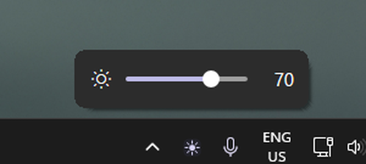

# Brightfly

<p align="center">
  
</p>

Brightness slider for external monitors on Windows 11, with a flyout that
mirrors the Windows volume flyout. Written with native Rust + Win32 and
Direct2D: no WebView, no XAML runtime, no large dependencies.

- exe size ± 0.31 MB (including the multi-resolution icon)
- Standard Windows wizard installer (Inno Setup) ± 2.2 MB, per-user, no admin
- Idle ± 10.6 MB working set, 2 threads, 0% CPU
- English UI, tray menu, and command-line output
- DDC/CI VCP `0x10`; gamma ramp as fallback
- One slider row per monitor; optional sync
- Monitor rescan on a background thread after display changes or resume
- Per-monitor values are keyed from EDID, so they survive moving the cable to another port
- Brightness values and settings are stored in `%APPDATA%\Brightfly\config.ini`
- Per-user autostart through `HKCU\...\CurrentVersion\Run`

Ready-to-use downloads are on the [Releases](https://github.com/nafnaufal/brightfly/releases) page.

## Installation

Download `brightfly-<version>-setup.exe` from
[Releases](https://github.com/nafnaufal/brightfly/releases), run it, and follow
the wizard (Next → Install → Finish). It is built with Inno Setup and behaves
like a regular Windows installer:

- Installs to `%LOCALAPPDATA%\Programs\Brightfly`; no administrator rights
- Creates a Start Menu shortcut and a Settings → Apps entry
- **Start Brightfly when I sign in** is checked by default; a desktop shortcut
  is optional
- Offers to launch the app when the wizard finishes

Uninstall through **Settings → Apps → Brightfly → Uninstall** (or
`unins000.exe` in the installation folder). Settings in
`%APPDATA%\Brightfly\config.ini` are kept, so your brightness values survive a
reinstall; delete that folder manually to start fresh. Running the installer
again upgrades in place, even if Brightfly is still running.

The zip `brightfly-<version>-win64.zip` contains the portable
`brightfly.exe` plus `README.md` and `LICENSE`. It can be run directly with no
installation.

### SmartScreen

Release builds are unsigned, so Windows may show **"Windows protected your
PC"** the first time the installer is run. That is expected for a new unsigned
project, not a corrupted download.

Allow it once:

1. Click **More info**.
2. Click **Run anyway**.

Or remove the "downloaded from the internet" mark first, which skips the
prompt entirely:

```powershell
$setup = Get-ChildItem .\brightfly-*-setup.exe | Select-Object -First 1
Unblock-File $setup
& $setup
```

The same can be done in Explorer: right-click the file → **Properties** →
tick **Unblock** → **OK**.

Verify the download before running it:

```powershell
certutil -hashfile $setup.FullName SHA256
```

Compare the output with the matching line in `SHA256SUMS.txt` from the same
release.

## Usage

Run `brightfly.exe`. A sun icon appears in the tray area. The app is a GUI
process: it opens no console window, and closing a terminal never affects it.

| Action | Result |
|---|---|
| Left-click the tray icon | Open/close the flyout |
| Drag the thumb or click the track | Change monitor brightness |
| Left/right or up/down arrows while the flyout has focus | Adjust by `step` |
| Mouse wheel over the flyout | Adjust by `step` |
| `Esc` | Close the flyout and save the value |
| Click outside the flyout / another window | Close the flyout and save the value |
| Right-click the tray icon | Sync, autostart, and quit menu |

Launching the exe a second time does not create another instance; the existing
instance opens its flyout.

## Command line

```
brightfly probe          List monitors, method, range, and current value
brightfly set <0..100>   Set every monitor, then read back to verify
brightfly stress         Send 200 rapid changes to exercise coalescing
brightfly --version
```

These commands attach to the terminal they are started from and print there;
piped or redirected output works as usual. Because the exe is a GUI process,
some shells return to the prompt before the output appears; use a pipe
(`brightfly probe | Out-Host`) or `cargo run -- probe` when you need the shell
to wait. Without arguments the exe starts the tray app instead.

## Build

Requirements:

- Rust stable with the MSVC target (`rustup default stable-msvc`)
- Visual Studio Build Tools with the C++ workload (for `link.exe`)
- Windows SDK (optional, for `rc.exe`: icon + version info). Without it the
  build still succeeds with a warning and the tray falls back to the stock
  Windows icon.
- [Inno Setup 6](https://jrsoftware.org/isinfo.php), only needed for packaging
  (`winget install JRSoftware.InnoSetup`)

```powershell
cargo build --release
.\target\release\brightfly.exe
```

Running straight from source:

```powershell
cargo run                 # tray app
cargo run -- probe        # list monitors
cargo run -- set 70       # set brightness
```

Stop any existing instance first (`Get-Process brightfly | Stop-Process -Force`)
before `cargo run`; a second instance only opens the flyout of the first one.

`cargo test` runs the unit tests for the config parser, gamma, and flyout
layout.

## Packaging

```powershell
.\scripts\package.ps1
```

Builds the release exe, compiles `installer\brightfly.iss` with Inno Setup, and
produces three files in `dist\`:

- `brightfly-<version>-setup.exe` — the wizard installer
- `brightfly-<version>.exe` — portable single executable
- `brightfly-<version>-win64.zip` — portable exe + `README.md` + `LICENSE` + `assets/screenshot.png`

The script finds `ISCC.exe` through `%ISCC%`, `PATH`, or the default Inno Setup
install folder. Installation and uninstallation do not use admin; both only
write to HKCU and user folders.

## GitHub releases

Push a tag that matches the version in `Cargo.toml`:

```powershell
git tag v<version>
git push origin v<version>
```

The `.github/workflows/release.yml` workflow installs Inno Setup, runs the
tests, builds the package, and creates a GitHub Release containing:

- `brightfly-<version>-setup.exe`
- `brightfly-<version>.exe` (portable)
- `brightfly-<version>-win64.zip` (full zip)
- `SHA256SUMS.txt`

To build without creating a release (for example, to check CI), run the
workflow through **Actions → Release → Run workflow**. The result is available
as an artifact.

The tag must be exactly `v<version>`; otherwise the workflow fails before the
release is created.

Regenerate the icon with:

```powershell
.\scripts\make-icon.ps1
```

## Known limitations

- Scrolling over the tray icon is not supported. Windows 11 does not forward
  `WM_MOUSEWHEEL` to third-party tray icon callbacks; implementing it would
  require raw input or a global hook that adds idle overhead.
- Monitors without DDC/CI support still appear, but their slider is disabled
  when no gamma ramp is available either.
- Brightness over DDC/CI depends on monitor firmware. Some monitors respond
  slowly or reject VCP `0x10`.
- HDR, physical sleep/resume, unplug/replug, and real multi-monitor setups have
  not been tested thoroughly; the development machine has only one external
  monitor.
- Per-monitor keys come from the EDID serial number. Monitors that do not
  report a serial are only identified at the model level, so two identical
  units share the same value.
- Release builds are not code-signed. SmartScreen may warn; verify file hashes
  against `SHA256SUMS.txt`.

## License

MIT. See [LICENSE](LICENSE).
